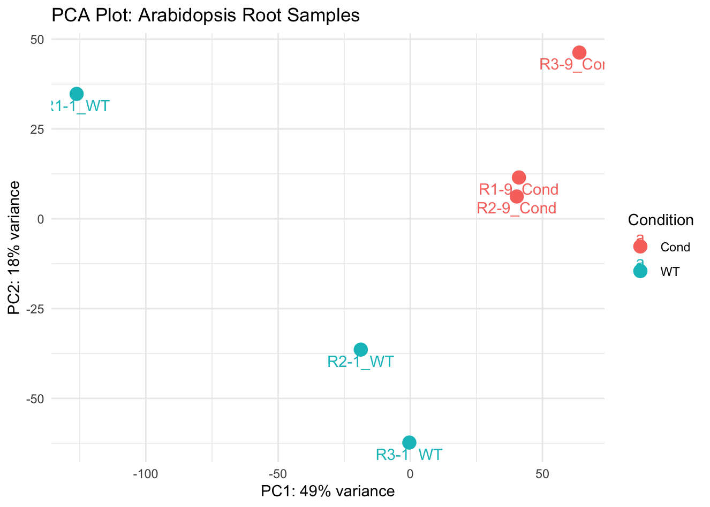

# Quality Control: PCA of the Six Pilot Libraries

**Date:** 2026-04-08  
**Stage:** 01_pilot_analysis  
**Script:** `modules/08_qc_pca.R`  
**Input:** TMM-normalised `DGEList` (`dge`, 20,971 genes), `phenodata`  
**Output:** `assets/001_pilot_qc_pca.png`

---

## 1. Method

* Log2-CPM values were computed from the TMM-normalised counts with a prior count of 2 (`cpm(dge, log = TRUE, prior.count = 2)`). The prior count limits the spread of log values for genes with very low counts.
* PCA was run with `prcomp()` on the transposed matrix (samples as rows). The data were centred but not scaled to unit variance (default `scale. = FALSE`).
* The percentage of variance per component was rounded to whole numbers for the axis labels.

---

## 2. Code (R)

```R
logCPM  <- cpm(dge, log = TRUE, prior.count = 2)
pca_res <- prcomp(t(logCPM))

pca_df <- data.frame(
    Sample    = rownames(pca_res$x),
    PC1       = pca_res$x[, 1],
    PC2       = pca_res$x[, 2],
    Condition = phenodata$condition
)

percentVar <- round(100 * (pca_res$sdev^2 / sum(pca_res$sdev^2)))

ggplot(pca_df, aes(x = PC1, y = PC2, color = Condition, label = Sample)) +
    geom_point(size = 4) +
    geom_text(vjust = 1.5) +
    theme_minimal() +
    xlab(paste0("PC1: ", percentVar[1], "% variance")) +
    ylab(paste0("PC2: ", percentVar[2], "% variance")) +
    ggtitle("PCA Plot: Arabidopsis Root Samples")
```

---

## 3. Result



* PC1 explains 49% and PC2 18% of the variance.
* **PC1:** `R1-1_WT` (about −125) is far from the other five libraries (about −19 to +64). Along PC1, the other two WT libraries lie between `R1-1_WT` and the Cond libraries.
* **PC2:** `R2-1_WT` and `R3-1_WT` have negative scores; the Cond libraries and `R1-1_WT` have positive scores. `R3-9_Cond` lies somewhat apart from the other two Cond libraries.

(Scores are approximate values read from the figure.)

---

## 4. Interpretation

`R1-1_WT` is the main outlier among the six libraries. It also had the lowest alignment rate (88.56% vs 90.88–93.78%; 2026-03-13 log) and a different count distribution (higher SD, lower median; 2026-03-23 log). The cause was not determined.

Because the groups have only three libraries each, a single outlier can strongly affect the dispersion estimates. The next log therefore compares models fitted with and without `R1-1_WT`.

Next step: differential expression (`modules/09_differential_analysis_lrt.R`).
