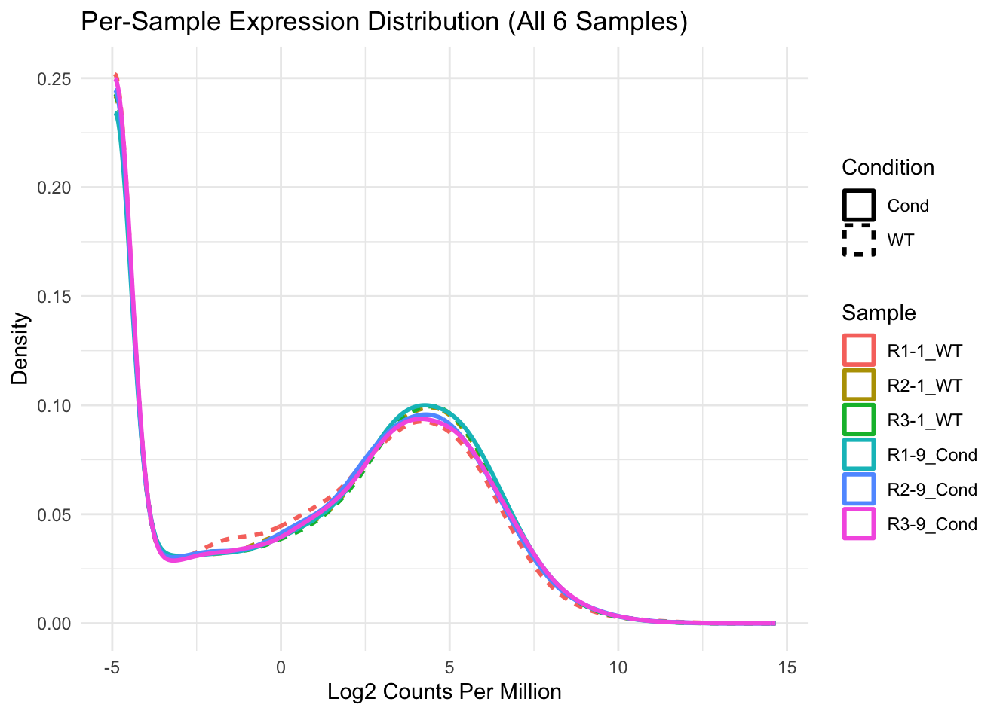
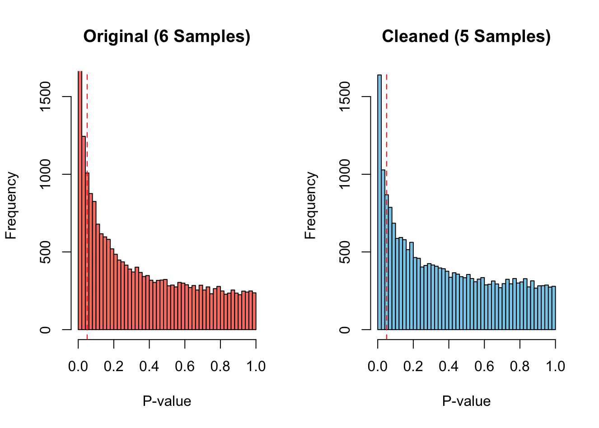

# Differential Expression: QLF and LRT Models

**Date:** 2026-04-08  
**Stage:** 01_pilot_analysis  
**Script:** `modules/09_differential_analysis_lrt.R`  
**Input:** TMM-normalised `DGEList` (`dge`), `counts`, `phenodata`  
**Output:** `assets/002_pilot_expression_density.png`, `assets/003_pilot_pvalue_histogram_6vs5.png`, LRT results (`res_lrt`) and gene list (`final_sig_genes`)

---

## 1. Methods

* **Model:** negative binomial GLM in edgeR with design `~group` (two groups, three libraries each).
* **Quasi-likelihood F-test (QLF; `glmQLFit`, `glmQLFTest`):** accounts for uncertainty in the gene-wise dispersion estimates. It is the test recommended by the edgeR authors for small experiments and is conservative with three replicates per group.
* **Likelihood ratio test (LRT; `glmFit`, `glmLRT`):** treats the estimated dispersions as known. With few replicates it is less conservative than the QLF test and can give more false positives.
* **Direction of log2FC:** the reference level of `group` is `Cond` (alphabetical), so coefficient 2 estimates WT relative to Cond. The column was renamed `Conditioned_vs_WT` in the six-library design, but it still estimates WT − Cond (the five- and four-library outputs label the same coefficient `group_cleanWT` and `group_finalWT`). **A positive log2FC means higher expression in WT.**

---

## 2. Models and code (R)

### A. Six libraries, QLF

```R
design <- model.matrix(~group)
colnames(design) <- c("Intercept", "Conditioned_vs_WT")   # coefficient 2 is WT vs Cond

dge <- estimateDisp(dge, design)
fit <- glmQLFit(dge, design)
qlf <- glmQLFTest(fit, coef = 2)
res_table <- topTags(qlf, n = Inf)$table
summary(decideTests(qlf))
#        Conditioned_vs_WT
# Down                   0
# NotSig             20970
# Up                     1
```

### B. Six libraries, robust QLF

```R
dge_robust <- estimateDisp(dge, design, robust = TRUE)
fit_robust <- glmQLFit(dge_robust, design, robust = TRUE)
qlf_robust <- glmQLFTest(fit_robust, coef = 2)
summary(decideTests(qlf_robust))
# Down 0, NotSig 20970, Up 1
```

### C. Five libraries (`R1-1_WT` removed), QLF

Filtering and TMM normalisation were repeated on the five remaining libraries.

```R
samples_to_keep <- setdiff(colnames(counts), "R1-1_WT")
counts_clean    <- counts[, samples_to_keep]
phenodata_clean <- phenodata[samples_to_keep, , drop = FALSE]

group_clean <- factor(phenodata_clean$condition)
dge_clean   <- DGEList(counts = counts_clean, group = group_clean)
keep        <- filterByExpr(dge_clean)
dge_clean   <- dge_clean[keep, , keep.lib.sizes = FALSE]
dge_clean   <- calcNormFactors(dge_clean)

design_clean <- model.matrix(~group_clean)
dge_clean    <- estimateDisp(dge_clean, design_clean)
fit_clean    <- glmQLFit(dge_clean, design_clean)
qlf_clean    <- glmQLFTest(fit_clean, coef = 2)
summary(decideTests(qlf_clean))
#        group_cleanWT
# Down               3
# NotSig         21268
# Up                 9

res <- topTags(qlf_clean, n = Inf)$table
sum(res$PValue < 0.01)   # 984
```

### D. P-value histograms and expression distributions

```R
# Six-library QLF fit, recomputed for the histogram
dge_6 <- DGEList(counts = counts, group = factor(phenodata$condition))
dge_6 <- dge_6[filterByExpr(dge_6), , keep.lib.sizes = FALSE]
dge_6 <- calcNormFactors(dge_6)
fit_6 <- glmQLFit(estimateDisp(dge_6, model.matrix(~factor(phenodata$condition))),
                  model.matrix(~factor(phenodata$condition)))
res_6 <- topTags(glmQLFTest(fit_6, coef = 2), n = Inf)$table

par(mfrow = c(1, 2))
hist(res_6$PValue, breaks = 50, col = "salmon", main = "Original (6 Samples)",
     xlab = "P-value", ylim = c(0, 1600))
abline(v = 0.05, col = "red", lty = 2)
hist(res$PValue, breaks = 50, col = "skyblue", main = "Cleaned (5 Samples)",
     xlab = "P-value", ylim = c(0, 1600))
abline(v = 0.05, col = "red", lty = 2)
sum(res_6$PValue < 0.01)   # 1101

# Density of log2-CPM values for all genes (raw counts, no filtering or TMM)
logCPM_all    <- cpm(counts, log = TRUE, prior.count = 2)
melted_counts <- melt(logCPM_all)
colnames(melted_counts) <- c("Gene", "Sample", "Log2CPM")
melted_counts$Condition <- ifelse(grepl("WT", melted_counts$Sample), "WT", "Cond")
ggplot(melted_counts, aes(x = Log2CPM, color = Sample, linetype = Condition)) +
    geom_density(linewidth = 1) +
    theme_minimal() +
    ggtitle("Per-Sample Expression Distribution (All 6 Samples)") +
    xlab("Log2 Counts Per Million") +
    ylab("Density")
```

### E. Six libraries, LRT

```R
dge_6    <- estimateDisp(dge, design)     # six-library DGEList and design from step A
fit_lrt  <- glmFit(dge_6, design)
lrt_test <- glmLRT(fit_lrt, coef = 2)
summary(decideTests(lrt_test))
#        Conditioned_vs_WT
# Down                 430
# NotSig             20039
# Up                   502

res_lrt <- topTags(lrt_test, n = Inf)$table
final_sig_genes <- res_lrt %>% filter(FDR < 0.05 & abs(logFC) > 1)
nrow(final_sig_genes)   # 865
```

### F. Four libraries (`R1-1_WT` and `R3-9_Cond` removed), QLF

```R
final_samples   <- c("R2-1_WT", "R3-1_WT", "R1-9_Cond", "R2-9_Cond")
counts_final    <- counts[, final_samples]
phenodata_final <- phenodata[final_samples, , drop = FALSE]

group_final <- factor(phenodata_final$condition)
dge_final   <- DGEList(counts = counts_final, group = group_final)
dge_final   <- dge_final[filterByExpr(dge_final), , keep.lib.sizes = FALSE]
dge_final   <- calcNormFactors(dge_final)

design_final <- model.matrix(~group_final)
dge_final    <- estimateDisp(dge_final, design_final)
fit_final    <- glmQLFit(dge_final, design_final)
qlf_final    <- glmQLFTest(fit_final, coef = 2)
summary(decideTests(qlf_final))
# Down 0, NotSig 21132, Up 0
```

---

## 3. Figures



All six libraries show a peak at about −5 log2-CPM (genes with zero counts) and a main peak at about 4–4.5 log2-CPM. `R1-1_WT` has slightly more genes between about −2.5 and 1 log2-CPM and a slightly lower main peak; otherwise the curves are similar.



Both QLF fits show an excess of small p-values. With six libraries, 1,101 genes have P < 0.01; with five libraries, 984. The first bin of the six-library histogram extends above the plotted range (ylim = 1,600).

---

## 4. Summary of models

| Libraries | Removed | Test | Residual df | Genes tested | FDR < 0.05 (higher in WT / higher in Cond) |
| :--- | :--- | :--- | ---: | ---: | :--- |
| 6 | — | QLF | 4 | 20,971 | 1 (1 / 0) |
| 6 | — | QLF, `robust = TRUE` | 4 | 20,971 | 1 (1 / 0) |
| 5 | `R1-1_WT` | QLF | 3 | 21,280 | 12 (9 / 3) |
| 4 | `R1-1_WT`, `R3-9_Cond` | QLF | 2 | 21,132 | 0 |
| 6 | — | LRT | 4 | 20,971 | 932 (502 / 430); 865 with \|log2FC\| > 1 |

---

## 5. Interpretation

* With three libraries per group, the QLF test found at most 12 genes at FDR < 0.05, whether or not `R1-1_WT` was included. Removing `R3-9_Cond` as well (two libraries per group) left no significant genes.
* Both p-value histograms show more small p-values than expected under no effect, so there is a signal that the QLF test does not resolve at this sample size.
* The LRT on all six libraries gave 932 genes at FDR < 0.05, of which 865 also had |log2FC| > 1. **No library was removed for this list.** Because the LRT is less conservative than the QLF test at n = 3 per group, the 865-gene list is treated as exploratory. It is used in the next two logs (volcano plot, heatmap, GO and KEGG).
