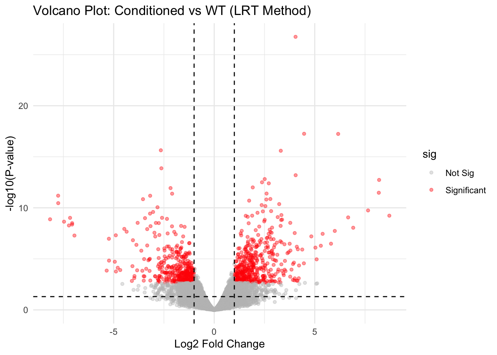
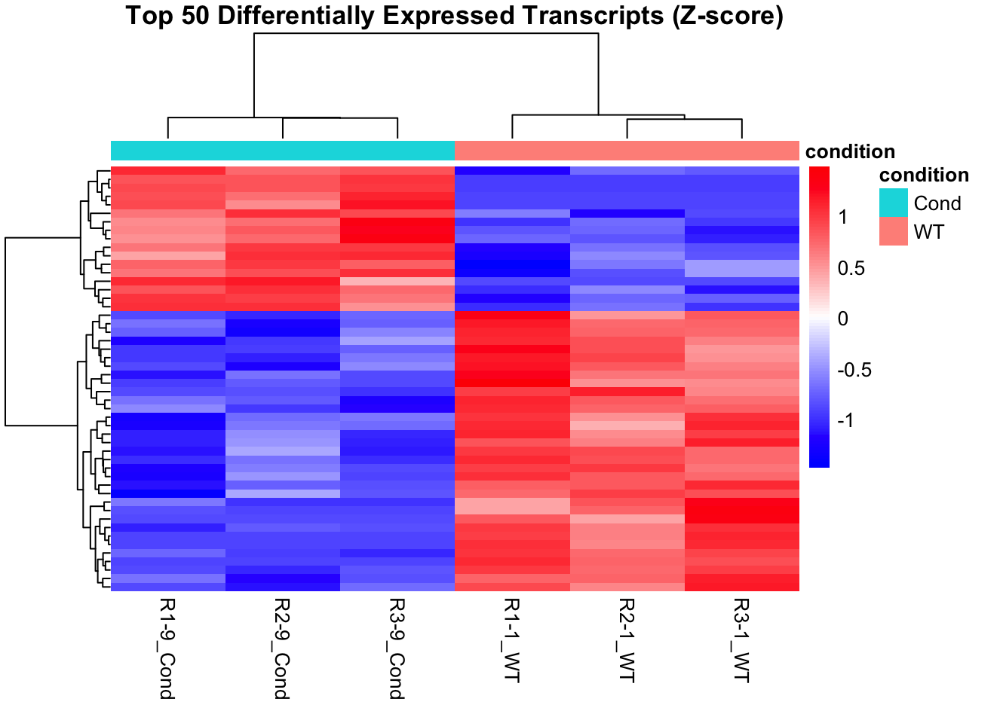

# Volcano Plot and Heatmap of the LRT Results

**Date:** 2026-04-09  
**Stage:** 01_pilot_analysis  
**Script:** `modules/10_visualization.R`  
**Input:** LRT results (`res_lrt`), 865-gene list (`final_sig_genes`), log-CPM matrix (`logCPM`, six libraries), `phenodata`  
**Output:** `assets/004_pilot_lrt_volcano.png`, `assets/005_pilot_top50_heatmap.png`

---

## 1. Methods

* **Volcano plot:** log2FC against −log10(P) for all 20,971 genes from the six-library LRT. Genes with FDR < 0.05 and |log2FC| > 1 are shown in red. The dashed lines mark |log2FC| = 1 and P = 0.05 (unadjusted).
* **Heatmap:** the 50 genes with the smallest p-values among the 865, shown as row Z-scores of log2-CPM across the six libraries. Rows and columns were clustered with `pheatmap` defaults (Euclidean distance, complete linkage).
* **Direction:** log2FC is WT relative to Cond (see the 2026-04-08 DE log). The plot title says "Conditioned vs WT", but **positive values mean higher expression in WT**.

---

## 2. Code (R)

```R
# Volcano plot
plot_data <- res_lrt
plot_data$sig <- ifelse(plot_data$FDR < 0.05 & abs(plot_data$logFC) > 1, "Significant", "Not Sig")

ggplot(plot_data, aes(x = logFC, y = -log10(PValue), color = sig)) +
    geom_point(alpha = 0.4, size = 1.2) +
    scale_color_manual(values = c("grey", "red")) +
    theme_minimal() +
    geom_vline(xintercept = c(-1, 1), linetype = "dashed") +
    geom_hline(yintercept = -log10(0.05), linetype = "dashed") +
    ggtitle("Volcano Plot: Conditioned vs WT (LRT Method)") +
    xlab("Log2 Fold Change") +
    ylab("-log10(P-value)")

# Heatmap of the top 50 genes (final_sig_genes is sorted by p-value)
top50_ids      <- rownames(final_sig_genes)[1:50]
heatmap_matrix <- logCPM[top50_ids, , drop = FALSE]
heatmap_scaled <- t(scale(t(heatmap_matrix)))   # row Z-scores

pheatmap(heatmap_scaled,
         cluster_rows = TRUE,
         cluster_cols = TRUE,
         show_rownames = FALSE,
         annotation_col = phenodata[, "condition", drop = FALSE],
         main = "Top 50 Differentially Expressed Transcripts (Z-score)",
         color = colorRampPalette(c("blue", "white", "red"))(100),
         border_color = NA)
```

---

## 3. Figures



* log2FC of the 865 genes ranges from about −8 to about +9. The smallest p-value (−log10 P ≈ 27) belongs to a gene with log2FC ≈ +4, i.e. higher in WT.
* There are more red points on the positive side (higher in WT) than on the negative side (higher in Cond).



* The libraries split into a WT cluster and a Cond cluster. `R1-1_WT` falls in the WT cluster; `R2-1_WT` and `R3-1_WT` are closest to each other.
* About one third of the 50 genes are higher in Cond and two thirds are higher in WT.
* `R1-1_WT` was part of the LRT fit that selected these genes, so its position in this heatmap is not an independent check of its quality.

Next step: mapping StringTie gene IDs (`MSTRG.*`) to TAIR IDs, then GO and KEGG enrichment (`modules/11_functional_enrichment.R`).
