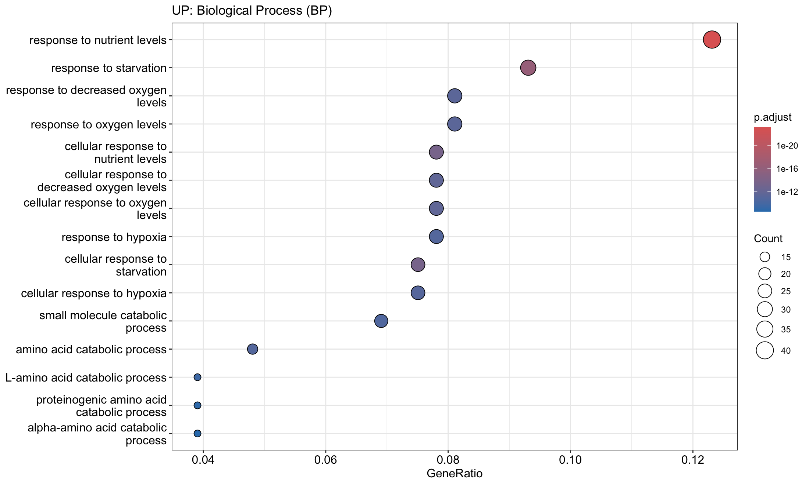
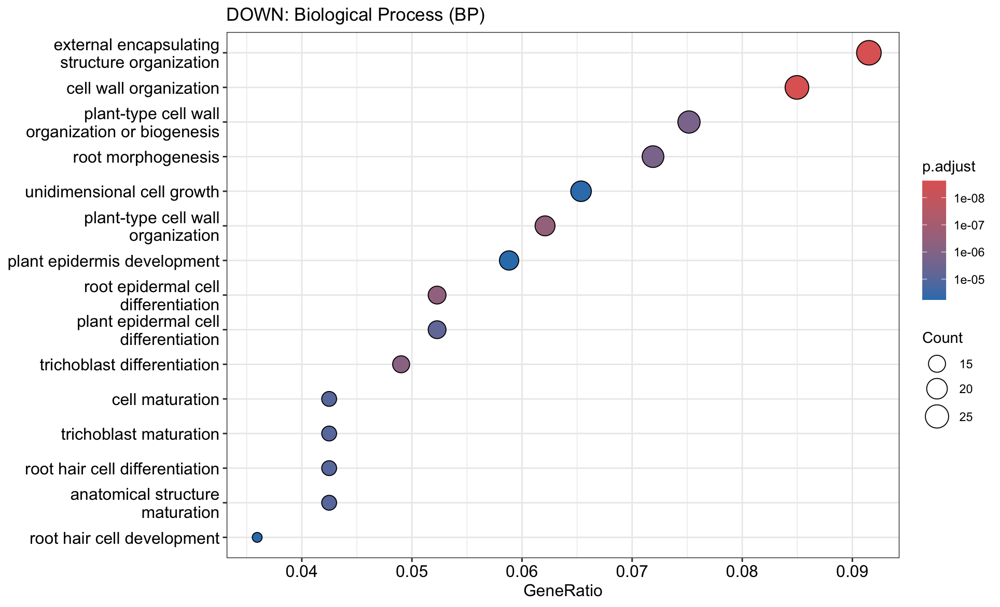
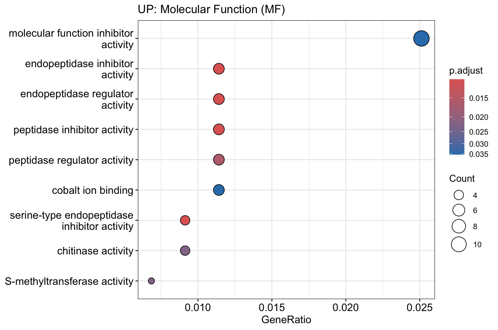
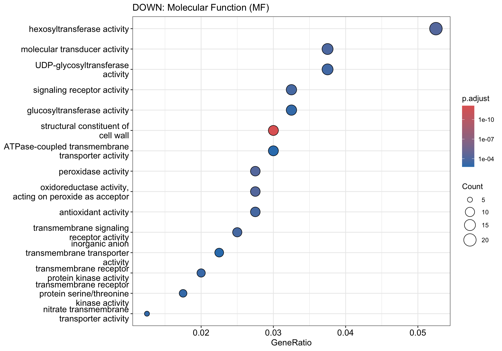
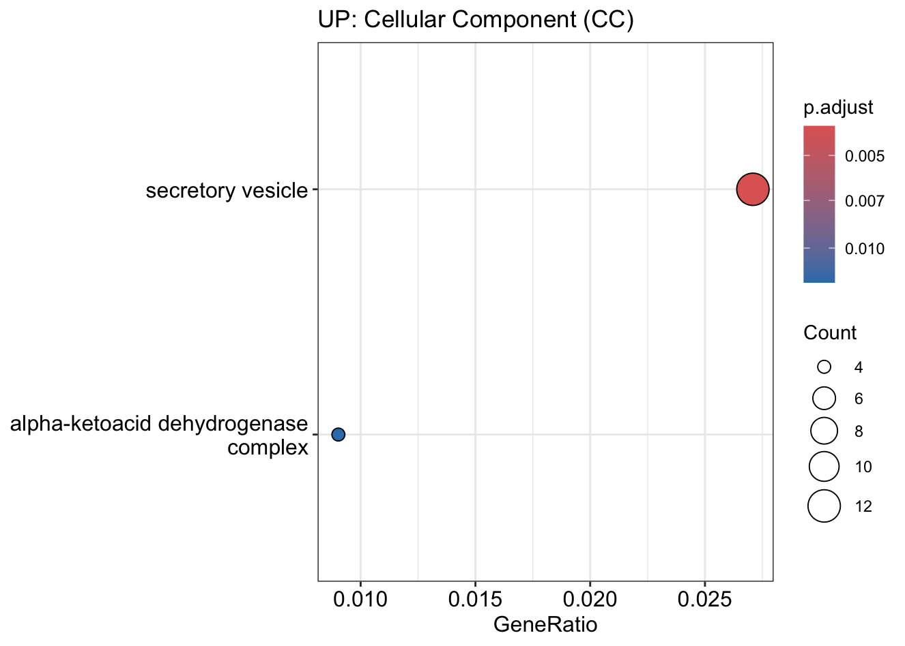
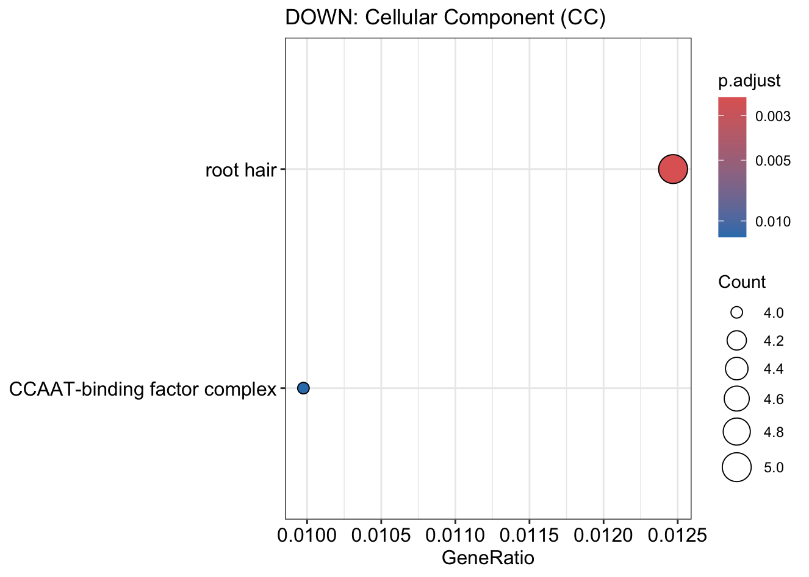
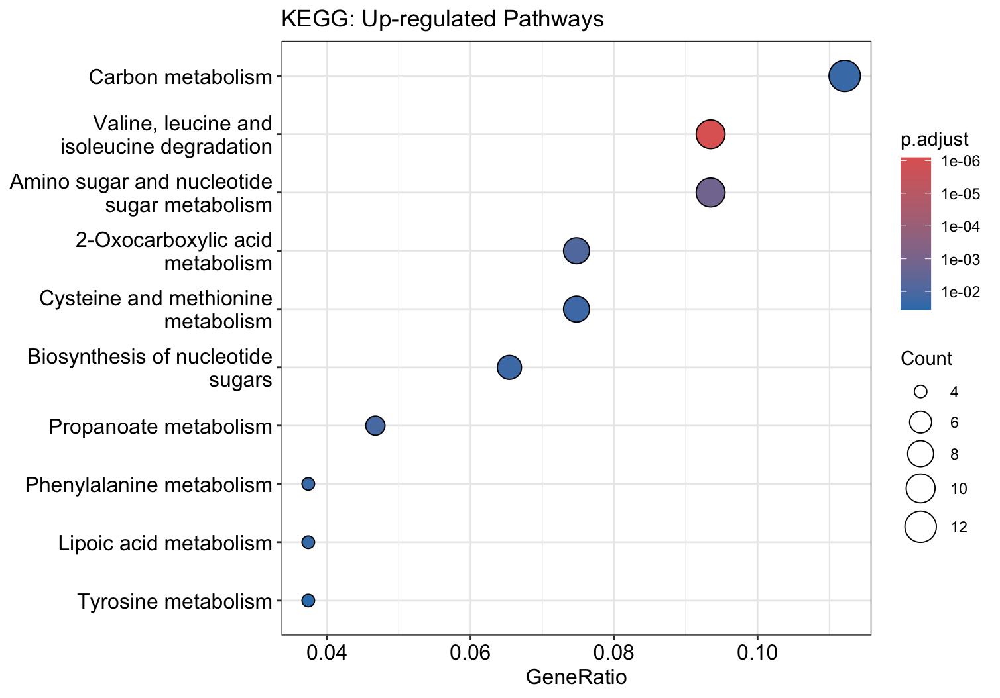
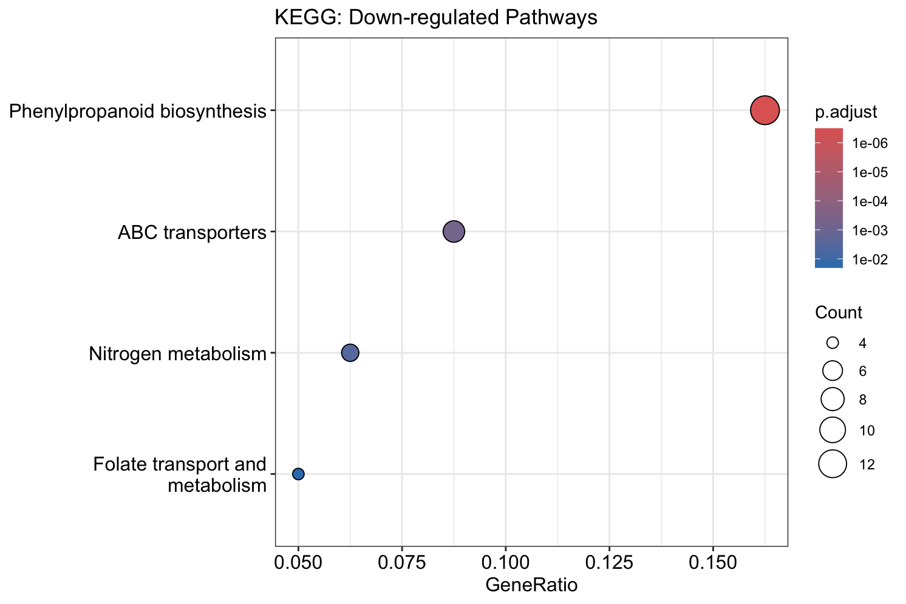

# ID Mapping and GO/KEGG Enrichment of the 865 LRT Genes

**Date:** 2026-04-11  
**Stage:** 01_pilot_analysis  
**Script:** `modules/11_functional_enrichment.R` (see the note in Section 5)  
**Input:** `final_sig_genes` (865 genes; six-library LRT, FDR < 0.05 and |log2FC| > 1), `ballgown/R1-1_WT/t_data.ctab`, `org.At.tair.db`  
**Output:** `assets/006_pilot_go_bp_up.png` to `assets/013_pilot_kegg_pathways_down.png`

---

## 1. Methods

* **ID mapping:** gene IDs in the count matrix are StringTie gene IDs (`MSTRG.*`) or TAIR loci. `t_data.ctab` links each `gene_id` to its transcripts (`t_name`). Removing the isoform suffix from `t_name` (e.g. `AT1G01420.1` → `AT1G01420`) gives the TAIR locus.
* **Gene sets:** genes were split by the sign of log2FC. Because log2FC is **WT relative to Cond** (see the 2026-04-08 DE log), the set used for the figures labelled "UP" contains genes **higher in WT** (lower in Cond), and the "DOWN" set contains genes **higher in Cond**.
* **GO:** `enrichGO` (org.At.tair.db, TAIR IDs; BP, MF and CC; adjusted p-value cutoff 0.05). No `universe` was given, so the background is all annotated genes in org.At.tair.db rather than the 20,971 genes tested.
* **KEGG:** `enrichKEGG` (organism `ath`, `keyType = "kegg"`, p-value cutoff 0.05) with TAIR IDs, which are the KEGG gene IDs for *Arabidopsis*.

---

## 2. Code (R)

```R
# MSTRG -> TAIR mapping
ctab <- read.table("ballgown/R1-1_WT/t_data.ctab", header = TRUE, sep = "\t")

id_map <- ctab %>%
  dplyr::select(gene_id, t_name) %>%
  mutate(tair_id = gsub("\\..*$", "", t_name)) %>%
  filter(grepl("^AT", tair_id)) %>%
  distinct(gene_id, tair_id)

final_sig_genes$gene_id <- rownames(final_sig_genes)
final_mapped <- merge(final_sig_genes, id_map, by = "gene_id")
cat("Mapping Check: We found TAIR IDs for", nrow(final_mapped), "out of", nrow(final_sig_genes), "MSTRG genes.\n")
# Mapping Check: We found TAIR IDs for 880 out of 865 MSTRG genes.
# (880 rows: some StringTie genes map to more than one TAIR locus)

# Gene sets (log2FC = WT relative to Cond)
up_ids_final   <- unique(final_mapped$tair_id[final_mapped$logFC > 1])    # higher in WT
down_ids_final <- unique(final_mapped$tair_id[final_mapped$logFC < -1])   # higher in Cond

# GO
go_up_BP   <- enrichGO(gene = up_ids_final,   OrgDb = org.At.tair.db, keyType = "TAIR", ont = "BP", pvalueCutoff = 0.05)
go_down_BP <- enrichGO(gene = down_ids_final, OrgDb = org.At.tair.db, keyType = "TAIR", ont = "BP", pvalueCutoff = 0.05)
# same calls with ont = "MF" and ont = "CC"
dotplot(go_up_BP, showCategory = 15) + ggtitle("UP: Biological Process (BP)")
dotplot(go_down_BP, showCategory = 15) + ggtitle("DOWN: Biological Process (BP)")

# Entrez IDs (computed, but not used below)
ids_mapped <- bitr(final_mapped$tair_id, fromType = "TAIR", toType = "ENTREZID", OrgDb = org.At.tair.db)
# Warning: 4.09% of input gene IDs are fail to map...

# KEGG with TAIR IDs
kegg_up   <- enrichKEGG(gene = up_ids_final,   organism = "ath", keyType = "kegg", pvalueCutoff = 0.05)
kegg_down <- enrichKEGG(gene = down_ids_final, organism = "ath", keyType = "kegg", pvalueCutoff = 0.05)
dotplot(kegg_up, showCategory = 15)
dotplot(kegg_down, showCategory = 15)
```

---

## 3. Results

In all figures, "UP" = higher in WT and "DOWN" = higher in Cond.

### A. GO Biological Process





* **Higher in WT:** response to nutrient levels and to starvation, responses to decreased oxygen levels and hypoxia, and amino-acid catabolic processes.
* **Higher in Cond:** cell wall organisation, root morphogenesis, unidimensional cell growth, epidermis development, root epidermal cell and trichoblast differentiation, and root hair cell differentiation and development.

### B. GO Molecular Function





* **Higher in WT:** peptidase and endopeptidase inhibitor activity, chitinase activity, cobalt ion binding and S-methyltransferase activity.
* **Higher in Cond:** hexosyl-, UDP-glycosyl- and glucosyltransferase activity, structural constituent of cell wall, peroxidase and antioxidant activity, signalling receptor and receptor kinase activity, and transmembrane transporter activities (including nitrate and inorganic anion transporters).

### C. GO Cellular Component





* **Higher in WT:** secretory vesicle and alpha-ketoacid dehydrogenase complex.
* **Higher in Cond:** root hair and CCAAT-binding factor complex.

### D. KEGG





* **Higher in WT:** carbon metabolism; valine, leucine and isoleucine degradation; amino sugar and nucleotide sugar metabolism; 2-oxocarboxylic acid metabolism; cysteine and methionine metabolism; and other amino-acid and sugar pathways.
* **Higher in Cond:** phenylpropanoid biosynthesis, ABC transporters, nitrogen metabolism, and folate transport and metabolism.

---

## 4. Interpretation and limits

* Compared with WT, Cond roots had higher expression of genes linked to cell walls, root hairs and the root epidermis (including peroxidases and phenylpropanoid biosynthesis), and lower expression of genes linked to nutrient starvation, hypoxia responses and amino-acid catabolism.
* These terms come from an exploratory gene list (six-library LRT, three libraries per group) and an enrichment test without an expressed-gene background. They describe differences between the two groups and were not validated by another method.

---

## 5. Note on the script

`modules/11_functional_enrichment.R` and `pipeline/run_downstream_pilot.R` pass Entrez IDs to `enrichKEGG`. The analysis that produced figures 012 and 013 passed TAIR IDs, as shown above. The scripts need to be aligned with this log.

---

## 6. Pilot summary

* `R1-1_WT` was the main outlier in QC (lowest alignment rate, different count distribution, separate on PC1). It was kept in the final model.
* QLF tests found at most 12 genes at FDR < 0.05, with or without `R1-1_WT`. The LRT on all six libraries found 932 genes at FDR < 0.05 (865 with |log2FC| > 1), and these were used for the enrichment analysis above.
* The next stage (`02_full_experiment`) analyses the 27-library factorial dataset (`Root00`) and its 12-library subset (`Root01`).
