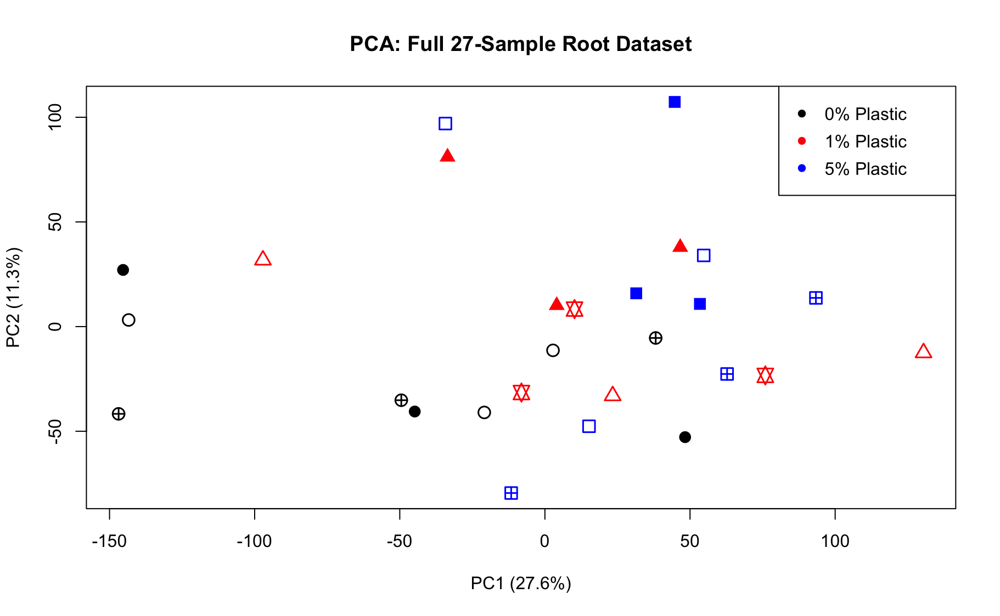
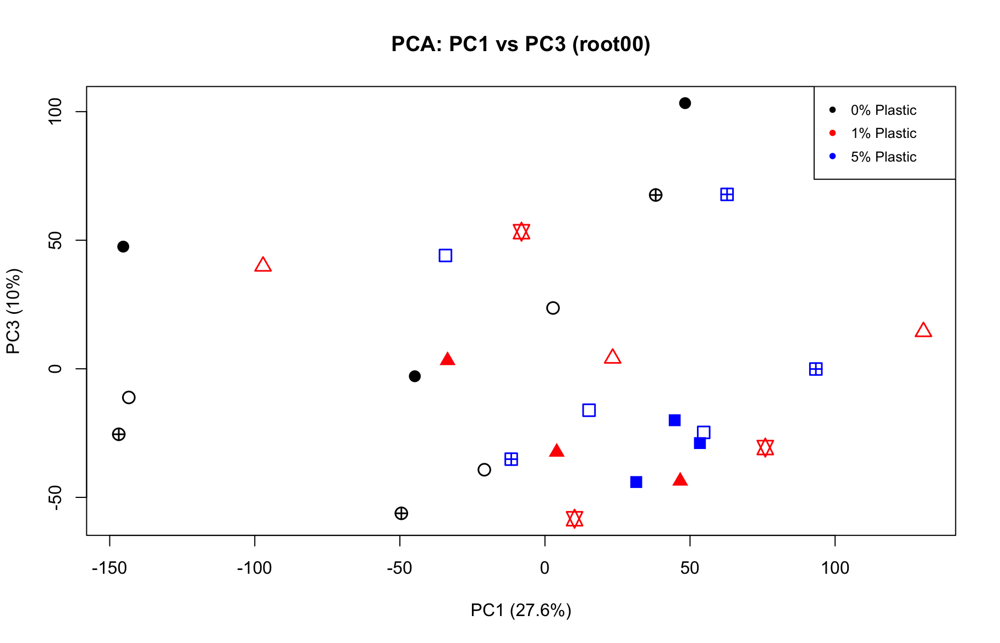
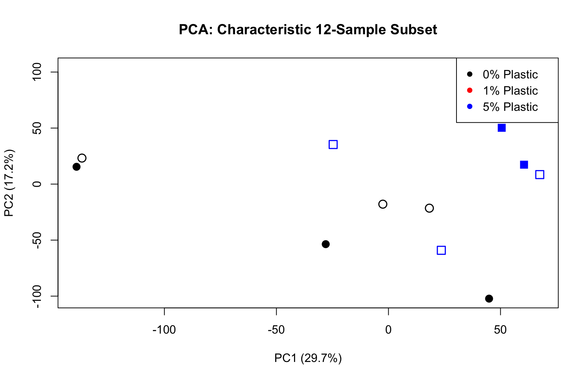

# PCA of the 27-Library Dataset (Root00) and the 12-Library Subset (Root01)

**Date:** 2026-04-11  
**Stage:** 02_full_experiment  
**Script:** `modules/01_full_matrix_and_subset_pca.R`  
**Input:** `Arabidopsis_plastics_2023.RData` (lab file: filtered, TMM-normalised `DGEList` objects `root00_y3` and `root01_y3`, plotting colours and symbols)  
**Output:** `assets/020_root00_full_matrix_pca.png`, `assets/021_root00_pca_pc1_vs_pc3.png`, `assets/022_root01_dose_response_pca.png`

---

## 1. Datasets

* **Root00:** all 27 libraries; LDPE at 0, 1 or 5% (w/w) × soil pre-incubation of 0, 30 or 120 days; 3 replicates per condition (R1–R9; see README).
* **Root01:** the 12 libraries of the four corner conditions, `c0_d0` (R1), `c5_d0` (R3), `c0_d120` (R7) and `c5_d120` (R9).

Each dataset was filtered (`filterByExpr`) and TMM-normalised separately in the lab script. Root01 retains 17,560 genes.

---

## 2. Code (R)

```R
load("../Plastic_RNAseq/Arabidopsis_plastics_2023.RData")

# Root00
TMM_root00_log <- cpm(root00_y3, normalized.lib.sizes = TRUE, log = TRUE)
TMM_root00_pca <- prcomp(t(TMM_root00_log), center = TRUE, scale = TRUE)
summary(TMM_root00_pca)

plot(TMM_root00_pca$x[, 1], TMM_root00_pca$x[, 2],
     pch = root00_pca_points, col = TMM_root00_subtype.col.vec01,
     xlab = "PC1 (27.6%)", ylab = "PC2 (11.3%)",
     main = "PCA: Full 27-Sample Root Dataset", cex = 1.5, lwd = 1.5)
legend("topright", legend = c("0% Plastic", "1% Plastic", "5% Plastic"),
       col = c("black", "red", "blue"), pch = 16)

# Root00, PC1 vs PC3
pca_summary <- summary(TMM_root00_pca)
pc3_var <- round(pca_summary$importance[2, 3] * 100, 1)
plot(TMM_root00_pca$x[, 1], TMM_root00_pca$x[, 3],
     pch = root00_pca_points, col = TMM_root00_subtype.col.vec01,
     xlab = "PC1 (27.6%)", ylab = paste0("PC3 (", pc3_var, "%)"),
     main = "PCA: PC1 vs. PC3 (root00)", cex = 1.5, lwd = 1.5)

# Root01
TMM_root01_log <- cpm(root01_y3, normalized.lib.sizes = TRUE, log = TRUE)
TMM_root01_pca <- prcomp(t(TMM_root01_log), center = TRUE, scale = TRUE)
summary(TMM_root01_pca)

plot(TMM_root01_pca$x[, 1], TMM_root01_pca$x[, 2],
     pch = root01_pca_points, col = TMM_root01_subtype.col.vec01,
     xlab = "PC1 (29.7%)", ylab = "PC2 (17.2%)",
     main = "PCA: Characteristic 12-Sample Subset", cex = 1.5, lwd = 1.5)
```

---

## 3. How to read the figures

The colours and symbols come from the lab script:

* **Colour = pre-incubation time:** black = day 0, red = day 30, blue = day 120.
* **Symbol shape = pre-incubation time:** circle = day 0, triangle = day 30, square = day 120.
* **Symbol fill = plastic level:** open = 0%, crossed (⊕, ✡, ⊞) = 1%, filled = 5%.

**The legend text in the committed figures 020–022 ("0% / 1% / 5% Plastic") is incorrect.** `modules/01_full_matrix_and_subset_pca.R` now draws one legend entry per condition. The legend colours correspond to the pre-incubation time, not to plastic level, and Root01 contains no 1% libraries. In figure 022 the legend also covers one of the `c5_d120` libraries (it is visible in figure 023).

---

## 4. Results

### Root00 (27 libraries)





* PC1 explains 27.6%, PC2 11.3% and PC3 10.0% of the variance.
* Day-120 libraries (blue) mostly have positive PC1 scores and day-0 libraries (black) mostly negative ones; day-30 libraries (red) are spread along PC1.
* Three day-0 libraries (one at each plastic level) lie apart from all others at PC1 ≈ −145.
* No grouping by plastic level is visible on PC1, PC2 or PC3.

### Root01 (12 libraries)



* PC1 explains 29.77% and PC2 17.29% of the variance (the axis labels in figure 022 were typed as 29.7% and 17.2%).
* The three `c5_d120` libraries (filled squares) lie together at positive PC1 and PC2.
* Two day-0 libraries (one 0%, one 5%) lie far from the rest at PC1 ≈ −138. The remaining libraries do not separate clearly by plastic level or by day.

The statistical tests on these scores and the PERMANOVA are in the 2026-04-15 log (Day: p = 0.010; Plastic: p = 0.722; Day × Plastic: p = 0.184).

Next step: likelihood ratio tests for the factorial contrasts (`modules/02_lrt_factorial_contrasts.R`).
