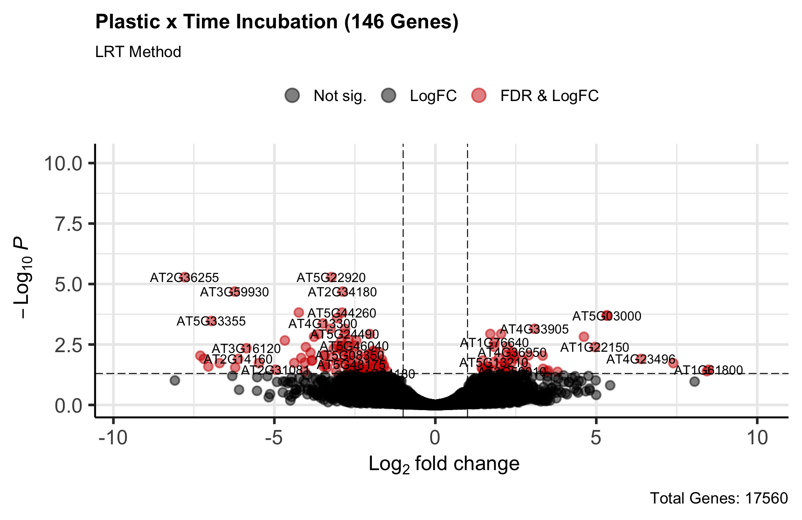
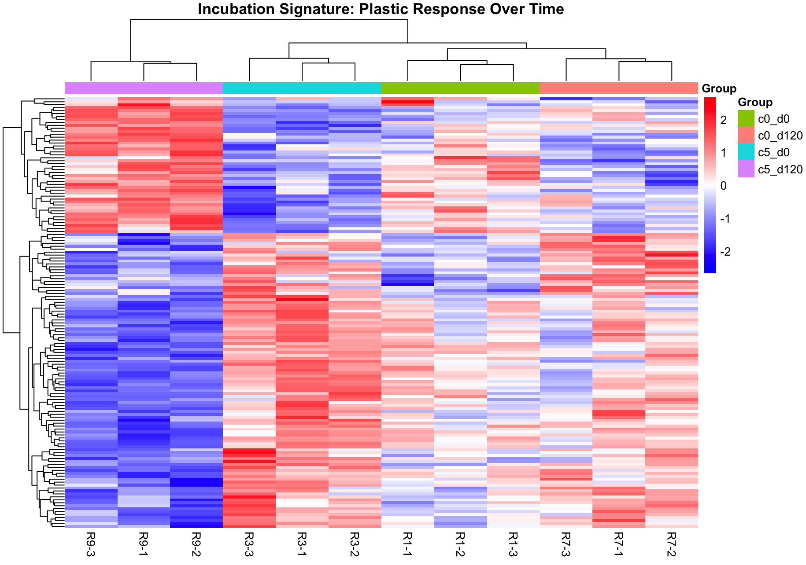
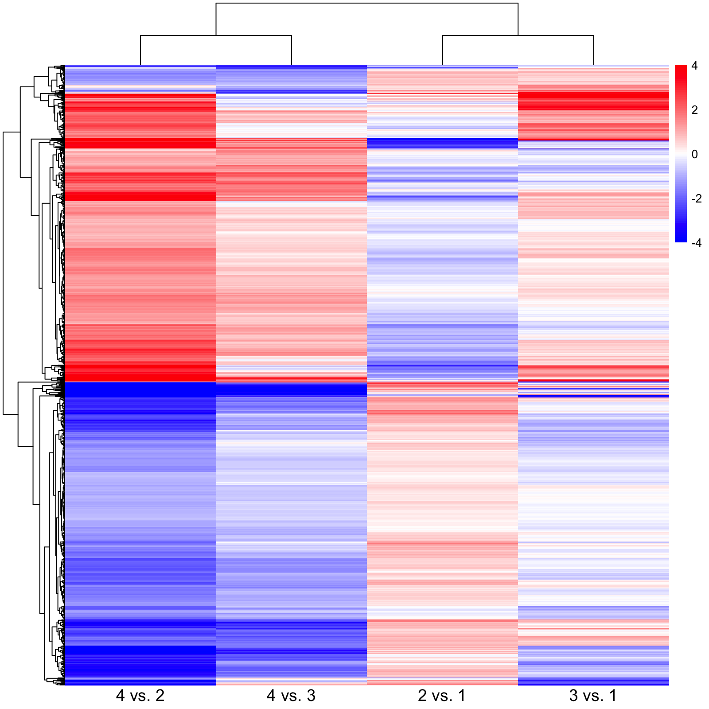

# Interaction Genes: Volcano Plot and Heatmaps (Root01)

**Date:** 2026-04-13  
**Stage:** 02_full_experiment  
**Script:** `modules/03_interaction_visualization.R`  
**Input:** Root01 LRT results (`res01_inter`, `res01_p0`, `res01_p120`, `res01_aging_c`, `res01_aging_p`), `TMM_root01_log`, `root01_group_02`  
**Output:** `assets/028_root00_lrt_volcano.png`, `assets/029_root01_interaction_heatmap.png`, `assets/030_root01_four_contrast_heatmap.png`

---

## 1. Methods

* **Volcano plot (028):** `EnhancedVolcano` on the Root01 interaction contrast `(c5_d120 - c5_d0) - (c0_d120 - c0_d0)`, with FDR on the y-axis (cutoffs FDR = 0.05 and |log2FC| = 1). The axis label reads "−Log10 P" (the package default), but the values plotted are −log10(FDR). Despite its file name, the figure shows Root01.
* **Heatmap of the 146 interaction genes (029):** TMM log-CPM values of the genes with FDR < 0.05 in the interaction contrast, scaled by row, clustered with Euclidean distance and complete linkage.
* **Log2FC heatmap (030):** genes with FDR < 0.05 in any of four Root01 contrasts (2 vs 1, 4 vs 3, 3 vs 1, 4 vs 2; 1 = `c0_d0`, 2 = `c5_d0`, 3 = `c0_d120`, 4 = `c5_d120`), coloured by log2FC (scale −4 to 4).

---

## 2. Code (R)

```R
# Volcano plot of the interaction contrast
res01_inter_df <- as.data.frame(topTags(res01_inter, n = Inf))
EnhancedVolcano(res01_inter_df,
                lab = rownames(res01_inter_df),
                x = 'logFC',
                y = 'FDR',
                title = 'Plastic x Time Incubation (146 Genes)',
                subtitle = 'LRT Method',
                pCutoff = 0.05,
                FCcutoff = 1.0,
                pointSize = 3.0,
                labSize = 4.0,
                col = c('black', 'black', 'black', 'red3'),
                legendLabels = c('Not sig.', 'LogFC', 'FDR', 'FDR & LogFC'),
                caption = paste0('Total Genes: ', nrow(res01_inter_df)))

# Heatmap of the 146 interaction genes
sig_inter_genes <- rownames(res01_inter_df[res01_inter_df$FDR < 0.05, ])
heatmap_data <- TMM_root01_log[sig_inter_genes, ]
ann_col <- data.frame(Group = root01_group_02)
rownames(ann_col) <- colnames(heatmap_data)
pheatmap(heatmap_data,
         scale = "row",
         clustering_distance_rows = "euclidean",
         clustering_method = "complete",
         show_rownames = FALSE,
         annotation_col = ann_col,
         main = "Incubation Signature: Plastic Response Over Time",
         color = colorRampPalette(c("blue", "white", "red"))(100))

# Log2FC heatmap for the union of genes from four contrasts
sig_genes_list <- unique(c(
  rownames(topTags(res01_p0,      n = Inf)$table[topTags(res01_p0,      n = Inf)$table$FDR < 0.05, ]),
  rownames(topTags(res01_p120,    n = Inf)$table[topTags(res01_p120,    n = Inf)$table$FDR < 0.05, ]),
  rownames(topTags(res01_aging_c, n = Inf)$table[topTags(res01_aging_c, n = Inf)$table$FDR < 0.05, ]),
  rownames(topTags(res01_aging_p, n = Inf)$table[topTags(res01_aging_p, n = Inf)$table$FDR < 0.05, ])))
heatmap_matrix <- cbind(
  "4 vs. 2" = topTags(res01_aging_p, n = Inf)$table[sig_genes_list, "logFC"],
  "4 vs. 3" = topTags(res01_p120,    n = Inf)$table[sig_genes_list, "logFC"],
  "2 vs. 1" = topTags(res01_p0,      n = Inf)$table[sig_genes_list, "logFC"],
  "3 vs. 1" = topTags(res01_aging_c, n = Inf)$table[sig_genes_list, "logFC"])
rownames(heatmap_matrix) <- sig_genes_list
pheatmap(heatmap_matrix,
         clustering_distance_rows = "euclidean",
         clustering_distance_cols = "euclidean",
         clustering_method = "complete",
         show_rownames = FALSE,
         color = colorRampPalette(c("blue", "white", "red"))(100),
         breaks = seq(-4, 4, length.out = 101),
         border_color = NA, fontsize_col = 14, angle_col = 0)
```

---

## 3. Results



* 17,560 genes were tested. The genes with FDR < 0.05 and |log2FC| > 1 (red) reach −log10(FDR) ≈ 5.3 at most (AT2G36255 and AT5G22920).
* More of these genes have negative interaction log2FC than positive.



* The first split of the column dendrogram separates the three `c5_d120` libraries from the other nine. Within the rest, the `c5_d0` libraries form one group and the `c0_d0` and `c0_d120` libraries another.
* About one third of the genes are higher in `c5_d120` and lower in `c5_d0`. The other two thirds show the opposite pattern. The `c0` libraries are intermediate.



* Most genes in the union come from the day-120 vs day-0 comparison in 5% soil (4 vs 2). The 4 vs 2 and 4 vs 3 columns cluster together, and the 2 vs 1 and 3 vs 1 columns cluster together.
* Genes that are lower in 4 vs 2 often have positive log2FC in 2 vs 1 (5% vs 0% at day 0), although that contrast had no significant genes on its own.

Next step: GO and KEGG analysis of the interaction genes (`modules/04_functional_enrichment.R`).
