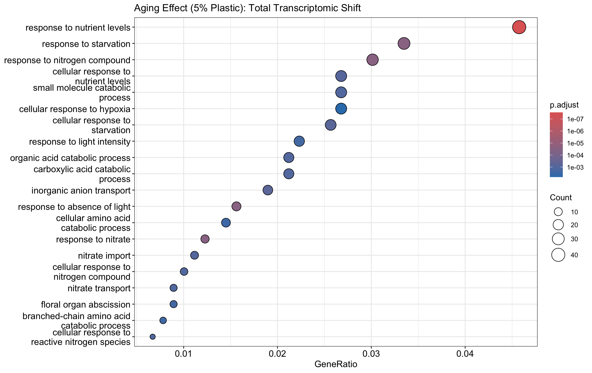
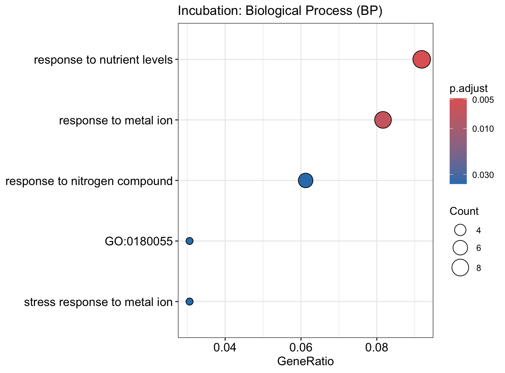
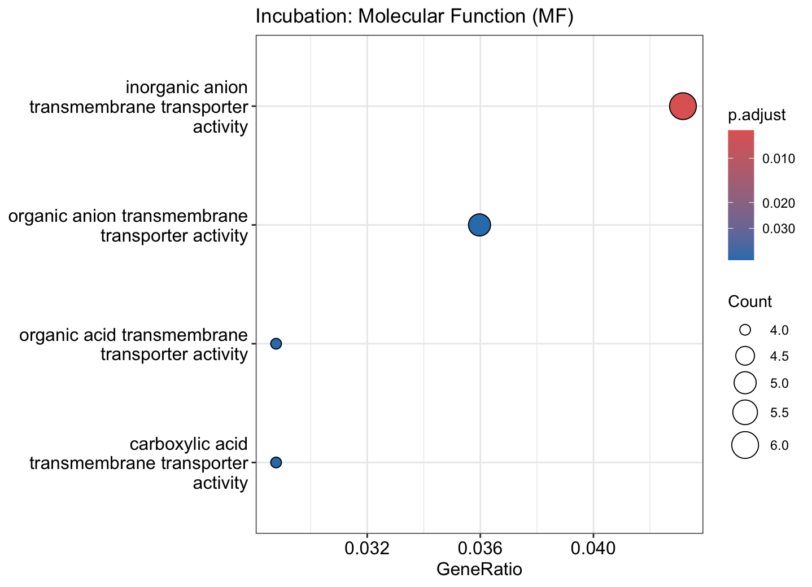
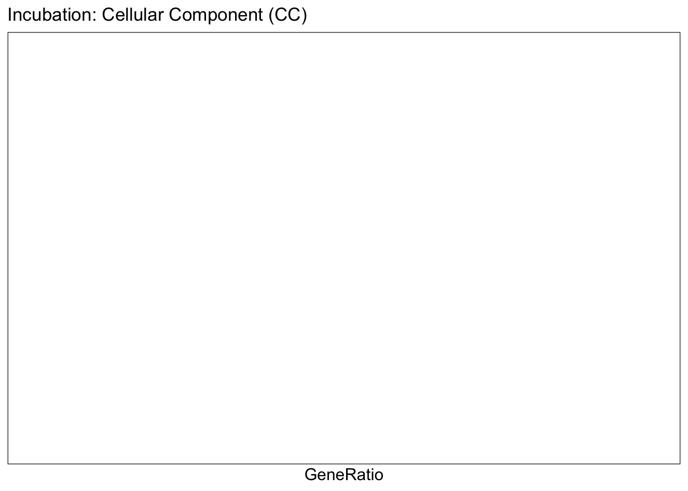
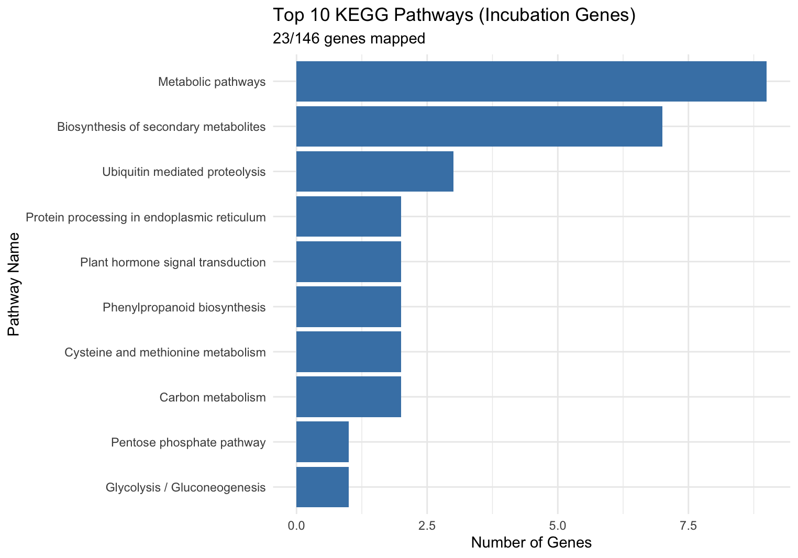

# GO and KEGG Analysis: Interaction Genes and Day-120 vs Day-0 Genes in 5% Soil

**Date:** 2026-04-13  
**Stage:** 02_full_experiment  
**Script:** `modules/04_functional_enrichment.R` (see the note in Section 4)  
**Input:** Root01 LRT results: interaction contrast (146 genes at FDR < 0.05) and day 120 vs day 0 at 5% (`c5_d120 - c5_d0`, 1,240 genes at FDR < 0.05); `org.At.tair.db`  
**Output:** `assets/034_aging_5p_go_bp.png`, `assets/035_interaction_go_bp.png`, `assets/036_interaction_go_mf.png`, `assets/037_interaction_go_cc.png`, `assets/038_interaction_kegg_top10.png`

---

## 1. Methods

* **Gene sets:** all genes with FDR < 0.05 in each contrast, without splitting by direction.
* **GO:** `enrichGO` (org.At.tair.db, TAIR IDs, adjusted p-value cutoff 0.05). No `universe` was given, so the background is all annotated genes rather than the 17,560 genes tested.
* **KEGG:** `enrichKEGG` (organism `ath`, TAIR IDs) was run for the 146 interaction genes. Figure 038 does not show an enrichment test. It shows how many of the 146 genes belong to each KEGG pathway; 23 of the 146 genes had a KEGG pathway assignment.
* **Mapping rates for the 146 interaction genes:** 139 had GO annotation and 23 had KEGG pathway annotation.

---

## 2. Code (R)

```R
# Interaction genes (146)
res01_inter_df  <- as.data.frame(topTags(res01_inter, n = Inf))
sig_inter_genes <- rownames(res01_inter_df[res01_inter_df$FDR < 0.05, ])

go_inter_BP <- enrichGO(gene = sig_inter_genes, OrgDb = org.At.tair.db, keyType = "TAIR",
                        ont = "BP", pvalueCutoff = 0.05)
go_inter_MF <- enrichGO(gene = sig_inter_genes, OrgDb = org.At.tair.db, keyType = "TAIR",
                        ont = "MF", pvalueCutoff = 0.05)
go_inter_CC <- enrichGO(gene = sig_inter_genes, OrgDb = org.At.tair.db, keyType = "TAIR",
                        ont = "CC", pvalueCutoff = 0.05)
dotplot(go_inter_BP, showCategory = 15) + ggtitle("Incubation: Biological Process (BP)")
dotplot(go_inter_MF, showCategory = 15) + ggtitle("Incubation: Molecular Function (MF)")
dotplot(go_inter_CC, showCategory = 15) + ggtitle("Incubation: Cellular Component (CC)")

# Day 120 vs day 0 at 5% (1,240 genes)
res01_aging_p_df  <- as.data.frame(topTags(res01_aging_p, n = Inf))
sig_aging_p_genes <- rownames(res01_aging_p_df[res01_aging_p_df$FDR < 0.05, ])
go_aging_p_BP <- enrichGO(gene = sig_aging_p_genes, OrgDb = org.At.tair.db, keyType = "TAIR",
                          ont = "BP", pvalueCutoff = 0.05)
dotplot(go_aging_p_BP, showCategory = 20) + ggtitle("Aging Effect (5% Plastic): Total Transcriptomic Shift")

# KEGG for the interaction genes
kegg_inter <- enrichKEGG(gene = sig_inter_genes, organism = 'ath', keyType = 'kegg', pvalueCutoff = 0.05)

# Pathway membership of the interaction genes (figure 038)
kegg_summary <- as.data.frame(table(kegg_check$Path))
colnames(kegg_summary) <- c("Pathway", "GeneCount")
kegg_summary <- kegg_summary[order(-kegg_summary$GeneCount), ]
# KEGG Mapping Rate:  23 out of 146
# GO Mapping Rate:    139 out of 146
```

---

## 3. Results

### A. Day 120 vs day 0 in 5% soil (1,240 genes)



The most significant terms are response to nutrient levels and to starvation, response to nitrogen compounds, cellular response to hypoxia, organic acid and amino-acid catabolic processes, response to light intensity and to absence of light, and nitrate import, transport and response.

### B. Interaction genes (146)



* **BP:** response to nutrient levels, response to metal ion, response to nitrogen compound, stress response to metal ion, and GO:0180055. The term name for GO:0180055 is missing from the plot; it is "response to metal ion starvation" (noted in the analysis script).



* **MF:** inorganic anion, organic anion, organic acid and carboxylic acid transmembrane transporter activities.



* **CC:** no term passed the cutoff, so the plot is empty.



* **KEGG (membership, not enrichment):** metabolic pathways (9 genes), biosynthesis of secondary metabolites (7), ubiquitin-mediated proteolysis (3), and 1–2 genes each in protein processing in the ER, plant hormone signal transduction, phenylpropanoid biosynthesis, cysteine and methionine metabolism, carbon metabolism, the pentose phosphate pathway and glycolysis/gluconeogenesis.

### C. Summary

Both gene sets are enriched for responses to nutrient levels and nitrogen compounds. The interaction genes are also enriched for metal-ion responses and anion/organic-acid transporters. The enrichment results describe these gene lists and have not been tested further.

---

## 4. Note on the script

`modules/04_functional_enrichment.R` has two statements on one line (line 70) and does not run as committed. Its KEGG summary also differs from the steps above. The script needs to be aligned with this log.

Next step: PERMANOVA and ANOVA on the Root01 PCA scores (`modules/05_multivariate_permanova.R`).
