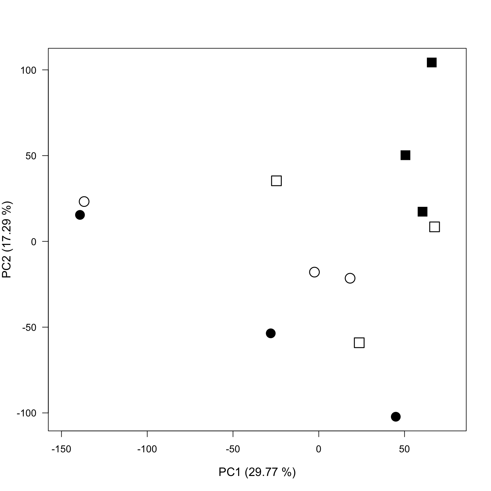
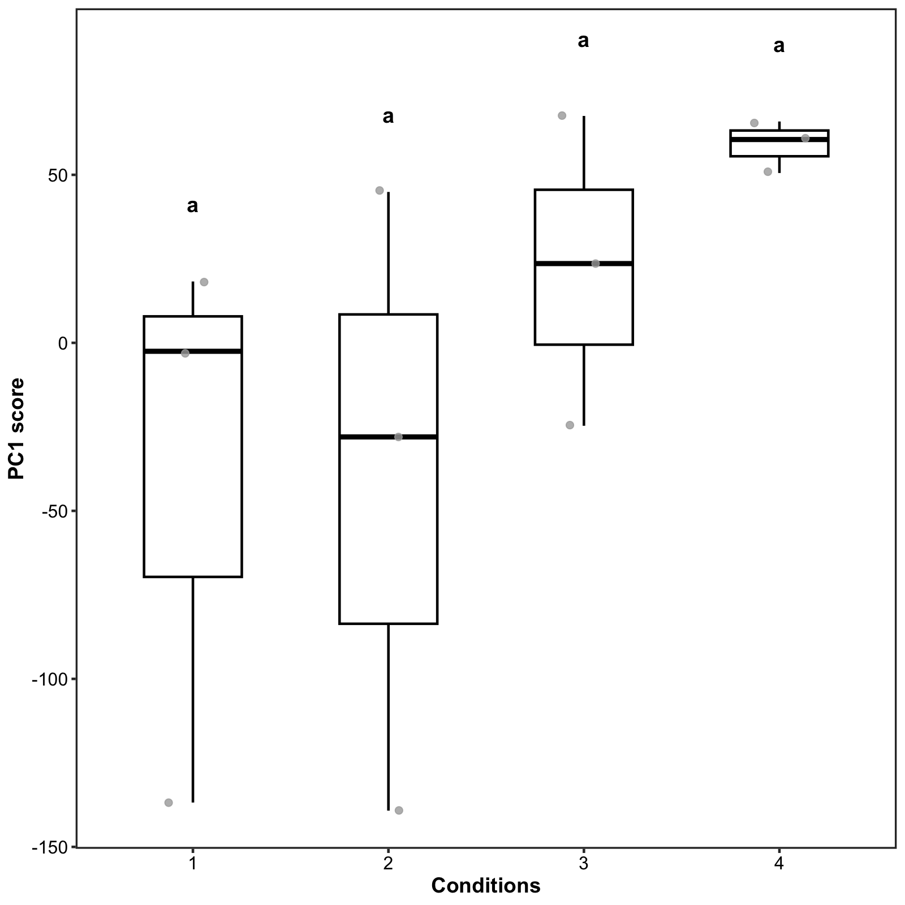
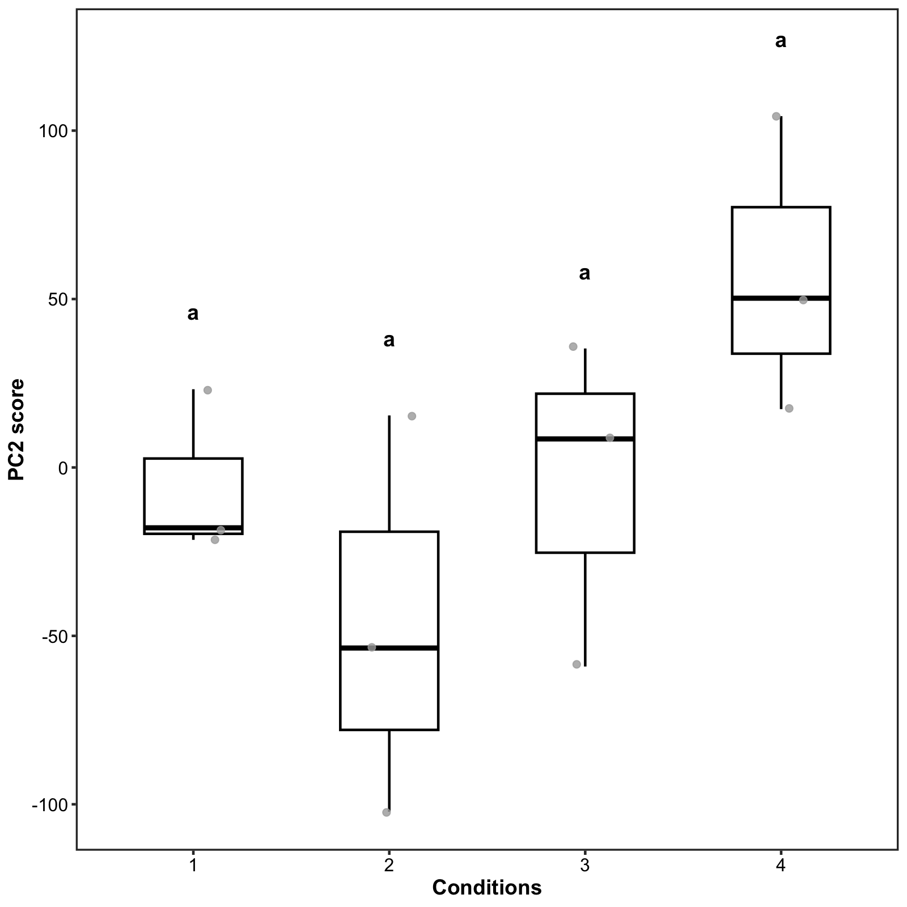
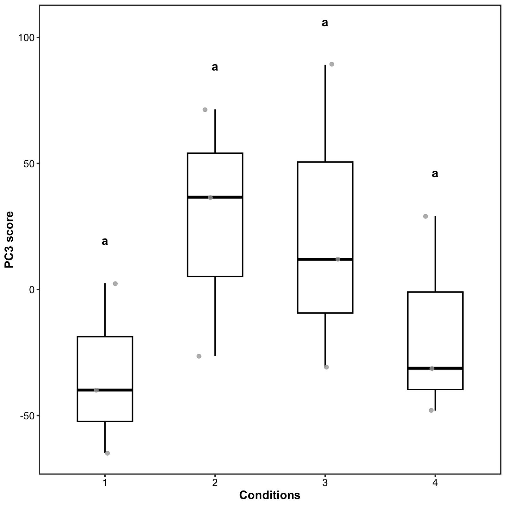

# PERMANOVA and Two-Way ANOVA on PCA Scores (Root01)

**Date:** 2026-04-15  
**Stage:** 02_full_experiment  
**Script:** `modules/05_multivariate_permanova.R`  
**Input:** `TMM_root01_log` (17,560 genes × 12 libraries), `TMM_root01_pca`  
**Output:** `assets/023_root01_publication_pca_2d.png`, `assets/024_root01_anova_pc1.png`, `assets/025_root01_anova_pc2.png`, `assets/026_root01_anova_pc3.png`

---

## 1. Methods

* **PERMANOVA:** `vegan::adonis2` on Euclidean distances between libraries computed from TMM log-CPM values, with the model `~ Day * Plastic`. Terms are added sequentially (`by = "terms"`), and the default 999 free permutations were used. No random seed was set.
* **Two-way ANOVA:** `aov(PCk ~ Day * Plastic)` for the scores on PC1, PC2 and PC3.
* **Boxplots and letters:** a one-way ANOVA across the four conditions, followed by Tukey HSD and `multcompLetters4`.
* **Conditions:** 1 = `c0_d0` (R1), 2 = `c5_d0` (R3), 3 = `c0_d120` (R7), 4 = `c5_d120` (R9). Metadata were assigned by column position (R1, R3, R7, R9; three libraries each).

---

## 2. Code (R)

```R
library(vegan)

meta_root01 <- data.frame(
  Day     = factor(rep(c("0d", "120d"), each = 6)),
  Plastic = factor(rep(c("0p", "5p", "0p", "5p"), each = 3)))
rownames(meta_root01) <- colnames(TMM_root01_log)

perma_results <- adonis2(t(TMM_root01_log) ~ Day * Plastic,
                         data = meta_root01, method = "euclidean", by = "terms")

# Two-way ANOVA on PC scores
pca_scores <- as.data.frame(TMM_root01_pca$x[, 1:2])
anova_data <- cbind(pca_scores, meta_root01)
summary(aov(PC1 ~ Day * Plastic, data = anova_data))
summary(aov(PC2 ~ Day * Plastic, data = anova_data))
pca_scores_3 <- as.data.frame(TMM_root01_pca$x[, 3]); colnames(pca_scores_3) <- "PC3"
summary(aov(PC3 ~ Day * Plastic, data = cbind(pca_scores_3, meta_root01)))

# Boxplots with Tukey letters (one-way ANOVA over the four conditions)
plot_df <- as.data.frame(TMM_root01_pca$x[, 1:3])
plot_df$Group <- gsub("-.*", "", rownames(plot_df))
plot_df$Condition <- factor(ifelse(plot_df$Group == "R1", "1",
                            ifelse(plot_df$Group == "R3", "2",
                            ifelse(plot_df$Group == "R7", "3", "4"))))
make_publication_boxplot <- function(df, pc_col, ylabel) {
  fit   <- aov(df[[pc_col]] ~ df$Condition)
  tukey <- TukeyHSD(fit)
  letters_list <- multcompLetters4(fit, tukey)
  # ... boxplot with jittered points and the letters above each box
}
```

---

## 3. Results

### A. PERMANOVA (999 permutations)

| Term | Df | Sum of squares | R² | F | p |
| :--- | ---: | ---: | ---: | ---: | ---: |
| Day | 1 | 19,584 | 0.195 | 2.427 | 0.010 |
| Plastic | 1 | 5,708 | 0.057 | 0.707 | 0.722 |
| Day × Plastic | 1 | 10,832 | 0.108 | 1.342 | 0.184 |
| Residual | 8 | 64,565 | 0.641 | | |
| Total | 11 | 100,690 | 1.000 | | |

### B. Two-way ANOVA on PC scores

| Component (% variance) | Term | Df | Sum of squares | F | p |
| :--- | :--- | ---: | ---: | ---: | ---: |
| PC1 (29.77%) | Day | 1 | 19,740 | 4.419 | 0.069 |
| | Plastic | 1 | 994 | 0.223 | 0.650 |
| | Day × Plastic | 1 | 1,040 | 0.233 | 0.642 |
| | Residuals | 8 | 35,737 | | |
| PC2 (17.29%) | Day | 1 | 8,171 | 3.887 | 0.084 |
| | Plastic | 1 | 330 | 0.157 | 0.702 |
| | Day × Plastic | 1 | 8,079 | 3.843 | 0.086 |
| | Residuals | 8 | 16,818 | | |
| PC3 (13.5%) | Day | 1 | 139 | 0.062 | 0.809 |
| | Plastic | 1 | 336 | 0.150 | 0.709 |
| | Day × Plastic | 1 | 7,737 | 3.458 | 0.100 |
| | Residuals | 8 | 17,897 | | |

The PC3 percentage was computed from the sums of squares above: the PCA was run on 17,560 scaled genes, so the total variance across the 12 libraries is 17,560 × 11. The same calculation reproduces the 29.77% and 17.29% given by `summary()` for PC1 and PC2.

### C. Figures



Symbols: open circle = Condition 1 (`c0_d0`), filled circle = Condition 2 (`c5_d0`), open square = Condition 3 (`c0_d120`), filled square = Condition 4 (`c5_d120`).







All four conditions share the letter "a" on PC1, PC2 and PC3, meaning that no pair of conditions differed significantly (Tukey HSD).

---

## 4. Interpretation

* Across all genes, only pre-incubation time (`Day`) had a significant effect (R² = 0.195, p = 0.010). Plastic (p = 0.722) and the Day × Plastic interaction (p = 0.184) were not significant, and 64% of the variance was residual (within-condition) variance.
* On the individual components, no term reached p < 0.05. The smallest p-values were for Day on PC1 (0.069) and for Day (0.084) and the interaction (0.086) on PC2.
* In the PC1 boxplot, the day-120 libraries tend to have higher scores. The three `c5_d120` libraries lie close together (PC1 ≈ 50–66), whereas one library each from `c0_d0` and `c5_d0` lies at about −140.
* With three libraries per condition these tests have limited power.
