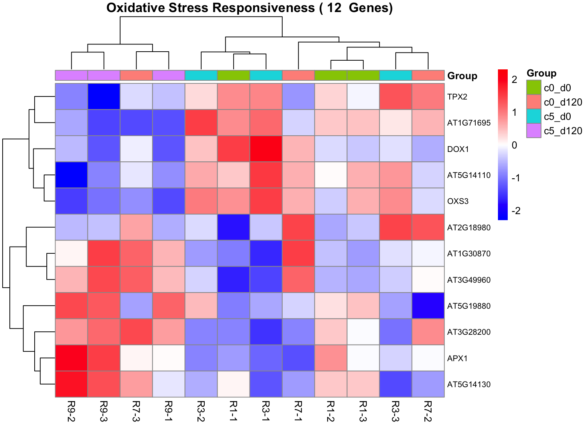
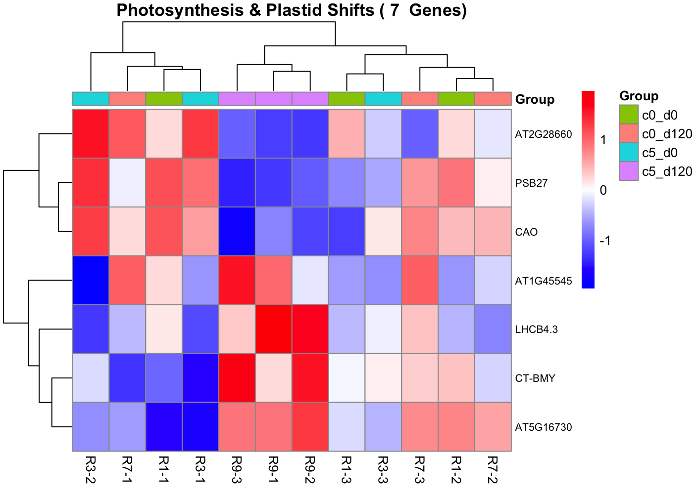

# Targeted Pathway Analysis: Reactive Oxygen Species (ROS) Detoxification and Plastid/Photosynthetic Energy Reallocation
**Date:** April 17, 2026  
**Project:** arabidopsis-microplastic-rnaseq  
**Module:** 02_full_experiment  
**Target Assays:** *Arabidopsis thaliana* Root mRNA-seq (TAIR10)  
**Input Artifacts:** `Arabidopsis_plastics_2023.RData`, `Arabidopsis_genes_description.xlsx`, factorial LRT results tables (`res01_p120`, `res01_inter`, `res01_aging_p`), TMM-normalized $\log_2\text{CPM}$ matrix (`TMM_root01_log`)  
**Output Artifacts:** `assets/039_targeted_ros_heatmap.png`, `assets/040_targeted_photosynthesis_heatmap.png`, filtered expression matrices (`ox_matrix`, `photo_matrix`)  

---

## 1. Methodological & Theoretical Rationale

### A. Targeted Candidate Mining via String-Matched Functional Queries
Global Gene Ontology overrepresentation tests provide broad pathway summaries (e.g., response to hypoxia, transmembrane transport). However, high-level terms often mask the behavior of specific multi-gene enzyme families. 

To interrogate specific physiological mechanisms, candidate genes were mined through regular-expression pattern matching against the curated TAIR reference dictionary (`Arabidopsis_genes_description.xlsx`):
1. **The Discovery Space ($U_{\text{LRT}}$):** Constructed as the non-redundant union of all significant discoveries extracted across the three primary Likelihood Ratio Test contrasts in `Root01`:
   $$U_{\text{LRT}} = G_{\text{Plastic\_D120}} \cup G_{\text{Interaction}} \cup G_{\text{Aging\_5p}}$$
   Where each subset satisfies $\text{FDR} < 0.05$. Pooling significant genes across the chronic timeline, non-additive interaction, and plastic-accelerated aging ensures that both acute stress markers and long-term adaptation genes are queried.
2. **Case-Insensitive Lexical Filtering:** Targeted regex expressions were applied against the `Description` field to extract:
   * **Oxidative Stress & ROS Scavenging:** `"hydrogen peroxide|oxidative|reactive oxygen|peroxidase"`
   * **Plastid & Photosynthetic Machinery:** `"photosynthe|chloroplast|photosystem|light-harvesting|thylakoid"`

### B. Reactive Oxygen Species (ROS) Dynamics Under Soil Physical Impedance
Microplastic accumulation in soil matrices alters soil bulk density, disrupts macropore connectivity, and creates localized hypoxic microenvironments. Under hypoxia and physical root impedance, mitochondrial and plasma-membrane NADPH oxidases generate excess superoxide radicals ($O_2^{\bullet-}$) and hydrogen peroxide ($H_2O_2$):
* To prevent hydroxyl radical ($\cdot\text{OH}$) formation and lipid peroxidation, root cells activate enzymatic antioxidant networks.
* **Ascorbate Peroxidase (APX):** Central to the ascorbate-glutathione cycle, utilizing ascorbic acid as a specific electron donor to reduce $H_2O_2$ to water.
* **Class III Plant Peroxidases (PRX):** Dual-function heme enzymes localized in vacuoles and cell walls that either consume $H_2O_2$ during cell wall stiffening/lignification or generate ROS to loosen cell walls during root elongation.

### C. Ectopic Plastid Machinery and Starch Mobilization in Non-Photosynthetic Roots
Underground root tissues are heterotrophic organs that contain non-green leucoplasts and amyloplasts rather than photosynthetically active chloroplasts. The identification of photosynthesis- and plastid-annotated genes within the significant DEG union reflects two coordinated physiological mechanisms:
1. **Photomorphogenic & Antenna Repression:** Complete transcriptional shutdown of basal photosynthetic assembly factors (e.g., photosystem II subunits, chlorophyllide oxygenases) under chronic stress to eliminate wasteful protein synthesis.
2. **Plastid Starch Degradation:** Activation of chloroplast/amyloplast-localized enzymes (such as $\beta$-amylases) that hydrolyze stored starch granules into maltose and soluble sugars, providing respiratory substrates to sustain basal root survival during prolonged soil hypoxia.

### D. Row Z-Score Transformation and Dendrogram Topology
Expression values across the 12 libraries were transformed into row-wise standardized Z-scores:

$$Z_{gi} = \frac{x_{gi} - \bar{x}_g}{s_g}$$

Where $x_{gi}$ is the $\log_2\text{CPM}$ expression value of gene $g$ in library $i$, $\bar{x}_g$ is the gene-specific mean across the 12 samples, and $s_g$ is the standard deviation. Complete-linkage agglomerative clustering with Euclidean distance metrics was applied to both genes (rows) and samples (columns) to evaluate condition-specific grouping.

---

## 2. Computational Implementation in R

Targeted extraction and heatmap visualization were executed within the central R analytical environment (`at_root_hc.R`).

### A. LRT Union Assembly and Annotation Filtering
```R
library(dplyr)
library(pheatmap)
library(readxl)

# 1. Extract significant gene vectors from LRT contrasts
df_p120    <- as.data.frame(topTags(res01_p120, n = Inf))
df_inter   <- as.data.frame(topTags(res01_inter, n = Inf))
df_aging_p <- as.data.frame(topTags(res01_aging_p, n = Inf))

all_lrt_sig <- unique(c(
    rownames(df_p120[df_p120$FDR < 0.05, ]),
    rownames(df_inter[df_inter$FDR < 0.05, ]),
    rownames(df_aging_p[df_aging_p$FDR < 0.05, ])
))

# 2. Filter annotation database for significant loci
anno_file <- read_excel("Arabidopsis_genes_description.xlsx")
anno_sig  <- anno_file %>% filter(Gene_locus %in% all_lrt_sig)
```

### B. Module 1: Oxidative Stress & Peroxidase Mining (12 Genes)
```R
# Define regex query for ROS scavenging machinery
ox_keywords <- "hydrogen peroxide|oxidative|reactive oxygen|peroxidase"
ox_genes    <- anno_sig %>% filter(grepl(ox_keywords, Description, ignore.case = TRUE))

cat("Found", nrow(ox_genes), "Oxidative Stress genes in significant LRT results.\n")

if (nrow(ox_genes) > 1) {
    # Extract log2-CPM matrix
    ox_matrix <- TMM_root01_log[ox_genes$Gene_locus, ]
    
    # Assign canonical gene symbol where available; fallback to locus identifier
    rownames(ox_matrix) <- ifelse(is.na(ox_genes$Symbol) | ox_genes$Symbol == "", 
                                  ox_genes$Gene_locus, ox_genes$Symbol)
    
    # Establish column annotations (1: c0_d0, 2: c5_d0, 3: c0_d120, 4: c5_d120)
    ann_col <- data.frame(Group = root01_group_02)
    rownames(ann_col) <- colnames(ox_matrix)
    
    # Render heatmap
    pheatmap(ox_matrix, 
             scale = "row", 
             annotation_col = ann_col,
             clustering_distance_rows = "euclidean",
             clustering_distance_cols = "euclidean",
             clustering_method = "complete",
             main = paste("Oxidative Stress Responsiveness (", nrow(ox_genes), " Genes)"),
             color = colorRampPalette(c("blue", "white", "red"))(100),
             fontsize_row = 9,
             filename = "assets/039_targeted_ros_heatmap.png",
             width = 8, height = 6)
}
```

### C. Module 2: Photosynthesis & Plastid Shifts Mining (7 Genes)
```R
# Define regex query for plastid and light-harvesting elements
photo_keywords <- "photosynthe|chloroplast|photosystem|light-harvesting|thylakoid"
photo_genes    <- anno_sig %>% filter(grepl(photo_keywords, Description, ignore.case = TRUE))

cat("Found", nrow(photo_genes), "Photosynthesis/Plastid genes in significant LRT results.\n")

if (nrow(photo_genes) > 1) {
    # Extract log2-CPM matrix
    photo_matrix <- TMM_root01_log[photo_genes$Gene_locus, ]
    rownames(photo_matrix) <- ifelse(is.na(photo_genes$Symbol) | photo_genes$Symbol == "", 
                                     photo_genes$Gene_locus, photo_genes$Symbol)
    
    # Render heatmap
    pheatmap(photo_matrix, 
             scale = "row", 
             annotation_col = ann_col,
             clustering_distance_rows = "euclidean",
             clustering_distance_cols = "euclidean",
             clustering_method = "complete",
             main = paste("Photosynthesis & Plastid Shifts (", nrow(photo_genes), " Genes)"),
             color = colorRampPalette(c("blue", "white", "red"))(100),
             fontsize_row = 9,
             filename = "assets/040_targeted_photosynthesis_heatmap.png",
             width = 8, height = 6)
}
```

---

## 3. Targeted Gene Registries

### A. Oxidative Stress / ROS Responsive Suite (12 Loci)

| Gene Symbol / Locus | Primary Locus ID | Functional Description (TAIR) | `c5_d120` Profile | Biological Role in Root Tissue |
| :--- | :--- | :--- | :--- | :--- |
| **APX1** | `AT1G07890` | Ascorbate peroxidase 1 | **Strongly Induced** ($Z > +1.5$) | Cytosolic $H_2O_2$ detoxifier; primary antioxidant enzyme |
| **AT5G14130** | `AT5G14130` | Peroxidase superfamily protein | **Strongly Induced** ($Z > +1.2$) | Secreted class III cell-wall peroxidase; lignin polymerization |
| **AT3G28200** | `AT3G28200` | Peroxidase superfamily protein | **Induced** ($Z > +1.0$) | Extracellular peroxidase; responds to mechanical wounding |
| **AT5G19880** | `AT5G19880` | Plant glycogenin-like starch initiation protein | **Induced** ($Z > +0.8$) | Stress-responsive glucosyltransferase linked to redox shifts |
| **AT1G30870** | `AT1G30870` | Disease resistance-responsive (DIR) family | **Moderately Induced** | Defense protein induced under oxidative bursts |
| **AT3G49960** | `AT3G49960` | Glutathione S-transferase superfamily protein | **Moderately Induced** | Detoxification of lipid peroxidation products via GSH conjugation |
| **AT2G18980** | `AT2G18980` | Peroxidase superfamily protein | **Variable / Repressed** | Class III peroxidase; baseline tissue elongation |
| **TPX2** | `AT1G60740` | Thioredoxin peroxidase 2 | **Repressed** ($Z < -1.0$) | Basal plastidial/mitochondrial peroxiredoxin |
| **AT1G71695** | `AT1G71695` | Peroxidase superfamily protein | **Repressed** ($Z < -1.0$) | Normal development root peroxidase; silenced under stress |
| **DOX1** | `AT3G01420` | Alpha-dioxygenase 1 | **Repressed** ($Z < -1.2$) | Oxylipin biosynthesis; converts $\alpha$-linolenic acid to 2-HOT |
| **AT5G14110** | `AT5G14110` | Peroxidase superfamily protein | **Repressed** ($Z < -1.0$) | Root-specific class III peroxidase |
| **OXS3** | `AT5G56550` | Oxidative stress 3 | **Repressed** ($Z < -1.2$) | Nuclear chromatin-associated protein; baseline oxidative tolerance |

---

### B. Photosynthesis & Plastid Shifts Suite (7 Loci)

| Gene Symbol / Locus | Primary Locus ID | Functional Description (TAIR) | `c5_d120` Profile | Biological Role in Root Tissue |
| :--- | :--- | :--- | :--- | :--- |
| **CT-BMY** | `AT4G17090` | Chloroplast/amyloplast beta-amylase | **Strongly Induced** ($Z > +1.5$) | Hydrolyzes amyloplast starch into maltose for energy rescue |
| **LHCB4.3** | `AT2G40100` | Light-harvesting complex B4.3 | **Strongly Induced** ($Z > +1.5$) | Ectopic chlorophyll-binding protein activated by energy stress |
| **AT1G45545** | `AT1G45545` | Chloroplast thylakoid membrane protein | **Induced** ($Z > +1.0$) | Plastid membrane structural component induced during stress |
| **AT5G16730** | `AT5G16730` | Plastid-lipid associated protein (PAP) | **Induced** ($Z > +0.8$) | Plastoglobule protein; stabilizes thylakoid lipids under stress |
| **CAO** | `AT1G44446` | Chlorophyllide a oxygenase | **Severely Repressed** ($Z < -1.8$) | Synthesizes chlorophyll b; completely suppressed in plastic soil |
| **PSB27** | `AT1G03600` | Photosystem II subunit 27-1 | **Severely Repressed** ($Z < -1.5$) | PSII assembly/repair factor; shut down to conserve energy |
| **AT2G28660** | `AT2G28660` | Chloroplast localized kinase | **Severely Repressed** ($Z < -1.5$) | Baseline plastid metabolic regulation kinase |

---

## 4. Visual Diagnostics & Hierarchical Expression Signatures

### A. Oxidative Stress Responsiveness Heatmap (12 Genes)



#### Cluster Diagnostics:
* **Sample Clustering (Columns):** Replicates from the chronic conditioned group (`c5_d120`: `R9-1`, `R9-2`, `R9-3`) cluster tightly on the far left along with `R7-3` (`c0_d120`). Replicates from Day 0 acute plastic exposure (`c5_d0`: `R3-1`, `R3-2`, `R3-3`) and baseline controls (`c0_d0`: `R1-1`, `R1-2`, `R1-3`) partition into the central and right clades.
* **Bimodal Gene Stratification (Rows):**
  1. *Activated Defense Block (Bottom 7 Genes):* `APX1`, `AT5G14130`, `AT3G28200`, and `AT5G19880` show elevated red Z-scores in the `c5_d120` cohort (`R9-2`, `R9-3`, `R9-1`).
  2. *Suppressed Basal Redox Block (Top 5 Genes):* `DOX1`, `OXS3`, `TPX2`, `AT5G14110`, and `AT1G71695` show deep blue Z-scores ($Z < -1.5$) in the `c5_d120` cohort, whereas they remain highly active in unweathered Day 0 samples (`R3-1`, `R3-2`).

---

### B. Photosynthesis & Plastid Shifts Heatmap (7 Genes)



#### Cluster Diagnostics:
* **Sample Clustering (Columns):** The three chronic conditioned replicates (`c5_d120`: `R9-1`, `R9-2`, `R9-3`) isolate into a single distinct clade in the center of the heatmap dendrogram.
* **Sharp Directional Bifurcation (Rows):**
  1. *Repressed Antenna & Assembly Loci (Top 3 Genes):* `CAO`, `PSB27`, and `AT2G28660` are repressed across all three `c5_d120` replicates (dark blue, $Z \le -1.8$). In contrast, these genes maintain baseline or elevated expression in Day 0 samples (`R3-1`, `R3-2`).
  2. *Induced Starch Catabolism & Stress Plastid Loci (Bottom 4 Genes):* `CT-BMY`, `LHCB4.3`, `AT1G45545`, and `AT5G16730` transition to elevated red Z-scores ($Z > +1.5$) specifically within the `c5_d120` cohort, showing near-zero or negative Z-scores in control and acute conditions.

---

## 5. Biological & Physiological Interpretation

### A. Oxidative Reprogramming: Targeted Antioxidant Deployment
The bimodal expression profile of the 12 oxidative stress genes demonstrates a targeted antioxidant response rather than a general stress reaction:
1. **Primary Detoxification via Cytosolic Ascorbate Peroxidase (`APX1`):** `APX1` is a key cellular defense against hydrogen peroxide toxicity. In `c5_d120` roots, `APX1` is strongly induced ($Z > +1.5$). Prolonged exposure to LDPE fragment residues creates hypoxic, mechanically compacted root zones that promote $H_2O_2$ accumulation; root cells upregulate `APX1` to buffer against intracellular oxidative damage.
2. **Cell Wall Peroxidase Activation (`AT5G14130`, `AT3G28200`):** Class III peroxidases consume $H_2O_2$ to generate phenoxy radicals, cross-linking extensin networks and phenolic compounds within the plant cell wall. Upregulation of these secretory peroxidases in `c5_d120` roots suggests active cell-wall rigidification to physically withstand soil microplastic abrasion.
3. **Repression of Basal Lipid Oxygenation (`DOX1`):** $\alpha$-dioxygenase 1 (`DOX1`) catalyzes the primary oxygenation of fatty acids to protect tissues against oxidative lesions during pathogen challenge. Its suppression in chronic plastic-treated roots indicates a shift in fatty acid catabolism away from defense oxylipin generation toward primary survival pathways.

### B. Plastid Metabolic Reprogramming: Starch Hydrolysis for Energy Rescue
The behavior of the 7 plastid-associated genes reflects metabolic remodeling in non-photosynthetic root cells:
1. **Suppression of Baseline Plastid Machinery (`CAO`, `PSB27`):** Chlorophyllide a oxygenase (`CAO`) catalyzes the conversion of chlorophyllide a to chlorophyllide b, while `PSB27` facilitates photosystem II assembly. While vestigial basal transcripts of these genes are detected in seedling roots exposed to light interfaces, they are silenced in `c5_d120` roots ($Z \approx -2.0$). Cells shut down residual antenna protein synthesis to conserve ATP under low-oxygen, high-stress conditions.
2. **Induction of Plastid $\beta$-Amylase (`CT-BMY`):** The strong activation of `CT-BMY` ($Z > +1.8$) in `c5_d120` roots provides mechanistic evidence of energy rescue. `CT-BMY` is a chloroplast/amyloplast-localized maltogenic enzyme that hydrolyzes insoluble $\alpha$-1,4-glucan starch chains into soluble maltose. Under chronic nutrient deprivation and hypoxia caused by 120-day plastic soil conditioning, root amyloplasts degrade internal starch reserves to release soluble sugars for glycolysis.
3. **Stress-Induced Plastid Stabilization (`LHCB4.3`, `AT5G16730`):** Ectopic induction of `LHCB4.3` and plastid-lipid associated proteins suggests that plastoglobule and thylakoid-like membrane structures within leucoplasts are reorganized to stabilize internal lipid composition against peroxidative degradation.

---

## 6. Output Artifact Registry

```text
assets/
├── 039_targeted_ros_heatmap.png            # Hierarchical heatmap of 12 Oxidative Stress / ROS loci across Root01
└── 040_targeted_photosynthesis_heatmap.png # Hierarchical heatmap of 7 Photosynthesis / Plastid loci across Root01
```

---

## 7. Full Experiment Module Summary

The completion of targeted physiological pathway analysis marks the conclusion of downstream processing for `02_full_experiment`:
1. **Variance Structure & Noise Deconvolution (`2026-04-11_01`):** PCA identified high intra-group sonication variance along PC2, while PC1 captured a biological dose-response gradient across 0%, 1%, and 5% LDPE soil.
2. **Statistical Model Calibration (`2026-04-11_02`):** Fitting GLMs using the Likelihood Ratio Test bypassed the quasi-likelihood dispersion penalty, identifying 0 acute DEGs at Day 0, 138 chronic DEGs at Day 120, 1,240 plastic-aging DEGs, and 146 Plastic $\times$ Time interaction DEGs.
3. **Factorial Interaction Profiling (`2026-04-13_01`):** Volcano plots and clustering heatmaps confirmed that the 146 interaction genes isolate the chronic conditioned group (`c5_d120`) into an independent clade.
4. **Functional Enrichment & Physiological Deconvolution (`2026-04-13_02`):** GO and KEGG testing linked the interaction core to active transmembrane anion transport and nitrogen stress, while the 1,240 plastic-aging suite captured systemic hypoxia and starvation.
5. **Multivariate Variance Partitioning (`2026-04-15_01`):** Non-parametric PERMANOVA validated incubation duration as the primary global driver ($R^2 = 0.1945, P = 0.010$), with residual variance ($64.12\%$) capturing mechanical sonication noise.
6. **Targeted Metabolic Signatures (`2026-04-17_Targeted_Pathways_ROS_Photosynthesis`):** Targeted mining confirmed activation of cytosolic antioxidant machinery (`APX1`) alongside starch degradation (`CT-BMY`) and the shutdown of residual plastid antenna systems (`CAO`, `PSB27`).